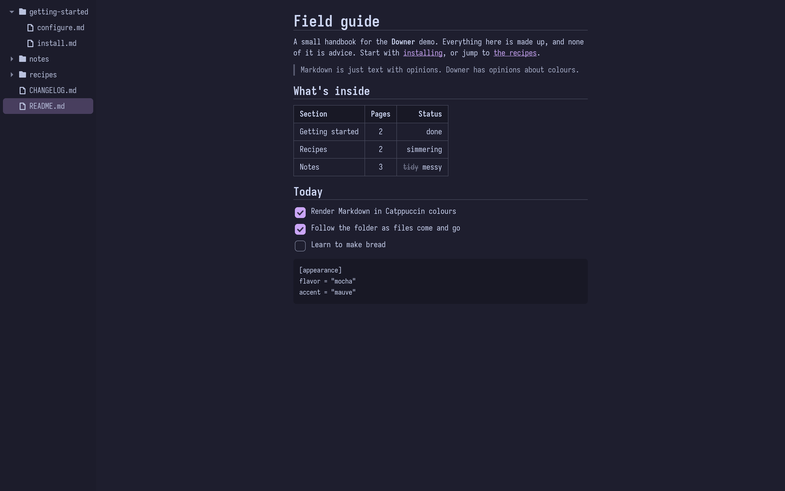
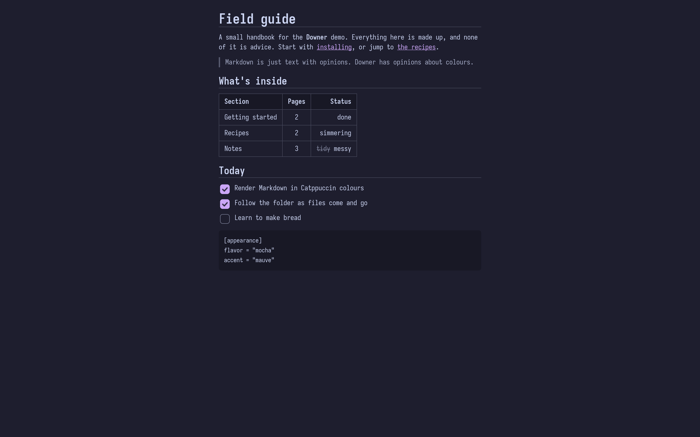
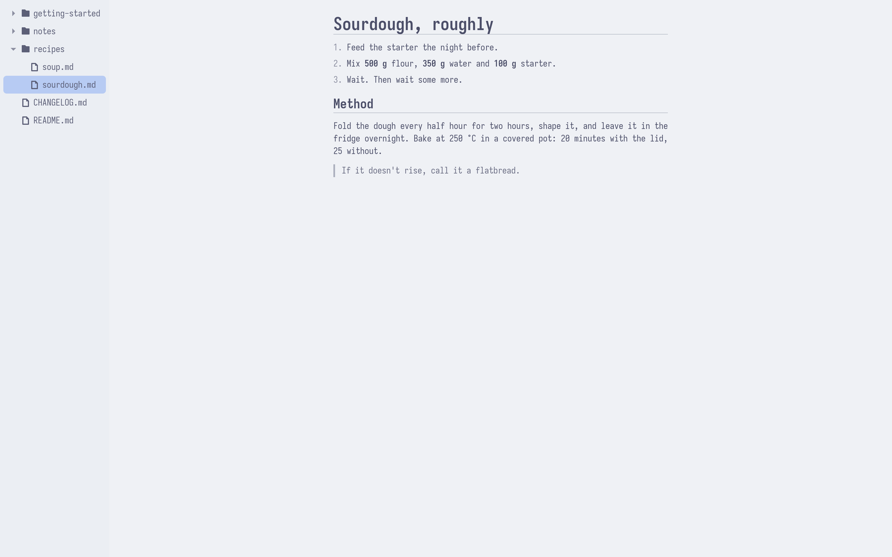
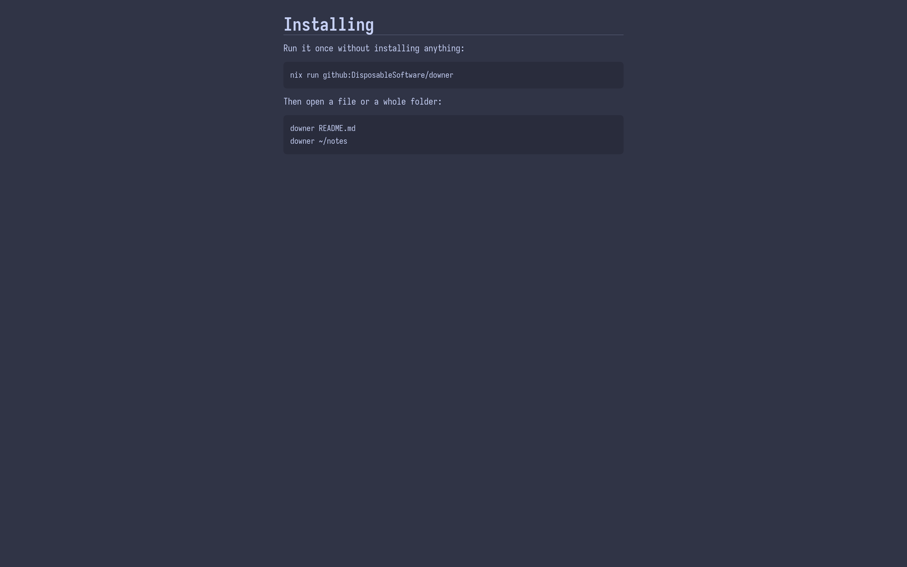

<h1 align="center">Downer</h1>

<p align="center">A small GTK 4 Markdown viewer for Hyprland, in Catppuccin colours.</p>

> [!WARNING]
> **Certified, artisanal, vibe-coded slop.**
>
> No human has read this code. An AI wrote all of it while a person said "yeah, looks
> good" and pressed Enter a lot. It shows Markdown files in Catppuccin colours and
> re-renders them when they change, which is more than anyone expected. It only ever
> reads your files, so the worst it can do is render them badly. If you need to read
> Markdown seriously, any text editor will do a better job.
>
> Bug reports will be read with great affection and then ignored.



Downer (`downer`) opens Markdown files, or whole folders of them, in a plain window with
no toolbar, status bar or libadwaita. It is built for tiling Wayland setups and is happy
to be the thing `xdg-open` starts for `.md` files.

## Features

- **Markdown:** CommonMark plus GitHub's extras: tables with alignment, strikethrough,
  task lists, code blocks, quotes and local images. Remote images are never fetched, and
  raw HTML is shown as text.
- **Folders:** pass a folder to get a sidebar with its Markdown files as a tree. It opens
  the README, follows files being added, renamed and deleted, and links to other files in
  the folder open in the same window.
- **Live reload:** the open file re-renders when it changes on disk, even when an editor
  saves by replacing it, and keeps your place.
- **Readable:** text is centred in a column of at most 75 characters, whatever the
  window width.
- **Catppuccin theming:** all four flavors and all 14 accents, a transparent window
  background, or `flavor = gtk` to follow your GTK theme (Stylix included).
- **Freedesktop integration:** a desktop entry for `text/markdown`, links opened in your
  default apps, and config in `$XDG_CONFIG_HOME`.

| | |
|---|---|
|  |  |
|  | |

## Install

Still here? Bold. Scroll up, reread the warning, then carry on.

### Nix

Try it without installing:

```sh
nix run github:DisposableSoftware/downer -- README.md
```

As a flake input, with the NixOS module:

```nix
{
  inputs.downer.url = "github:DisposableSoftware/downer";

  # in your NixOS configuration
  imports = [ inputs.downer.nixosModules.default ];
  programs.downer = {
    enable = true;
    defaultMarkdownViewer = true; # xdg-open file.md opens Downer
  };
}
```

Or with home-manager, which can also write your settings:

```nix
{
  imports = [ inputs.downer.homeManagerModules.default ];
  programs.downer = {
    enable = true;
    defaultMarkdownViewer = true;
    settings.appearance = { flavor = "latte"; accent = "blue"; opacity = 0.9; };
    style = "window.downer .h1 { color: @red; }";
  };
  xdg.mimeApps.enable = true; # home-manager only writes mimeapps.list when this is set
}
```

If you've run Downer before, it has already made a commented-out
`~/.config/downer/config.ini`, and home-manager will refuse to replace it. Delete that
file before setting `settings` (or set `home-manager.backupFileExtension`). There is also
an overlay, `overlays.default`, which adds `pkgs.downer`.

### From source

You need Rust 1.92 or newer, GTK 4.20 or newer, and `pkg-config`:

```sh
cargo build --release   # ./target/release/downer
```

To have launchers and `xdg-open` find it, copy
[`data/io.github.DisposableSoftware.Downer.desktop`](data/io.github.DisposableSoftware.Downer.desktop)
to `~/.local/share/applications/` and run `update-desktop-database ~/.local/share/applications`.

## Usage

```sh
downer README.md notes.md   # one window per file
downer ~/notes              # a folder: the sidebar tree, starting at its README
downer                      # an empty window with a hint
```

Make it the default for Markdown with
`xdg-mime default io.github.DisposableSoftware.Downer.desktop text/markdown`.

Downer runs as a single instance, so new windows open in the running process. Every
window has the Wayland app ID `io.github.DisposableSoftware.Downer`, which you can match in
Hyprland window rules.

In a folder window, keyboard focus starts in the tree: <kbd>↑</kbd> and <kbd>↓</kbd> move
between rows, and <kbd>Return</kbd> opens a file or opens and closes a folder. Text in the
document can be selected and copied with <kbd>Ctrl</kbd>+<kbd>C</kbd>.

## Configuration

Settings live in `~/.config/downer/config.ini`. The first time Downer starts, it creates
it with every option listed at its default but commented out: remove the `# ` from a line
to change it. It never writes to a file that already exists, so configs from dotfiles or
home-manager are left alone. Changes apply when Downer restarts. The same list is in
[`data/config.example.ini`](data/config.example.ini).

```ini
[appearance]
# latte, frappe, macchiato or mocha, or gtk to use your GTK theme's colours
flavor = mocha
accent = mauve
opacity = 0.85
```

For extra styling, put GTK CSS in `~/.config/downer/style.css`. The palette's colour
names (`@base`, `@mauve`, `@accent`, …) are available there, and Downer's own rules are
all under `window.downer`:

```css
window.downer .h1 { color: @peach; }
```

## Development

What Downer does is written down in [`spec/`](spec/README.md): every behaviour is a
numbered requirement, and the code follows it. `cargo test` checks the spec's tables
against the code and the example config.

```sh
nix develop                 # cargo, clippy, rustfmt, rust-analyzer, GTK 4
cargo run -- README.md
cargo clippy --all-targets -- -D warnings
cargo test
nix build                   # ./result/bin/downer
nix flake check             # tests, clippy, rustfmt and the NixOS module
git config core.hooksPath .githooks   # once per clone: the release check on push
```

The scripts in [`scripts/manual/`](scripts/manual) drive the app to check what unit tests
can't, such as rendering, reloading and the sidebar. Most run in a headless sway
(`scripts/manual/headless.sh`), so they work with the screen locked. The README
screenshots come from `scripts/screenshots.sh`.

## License

MIT, see [LICENSE](LICENSE).
